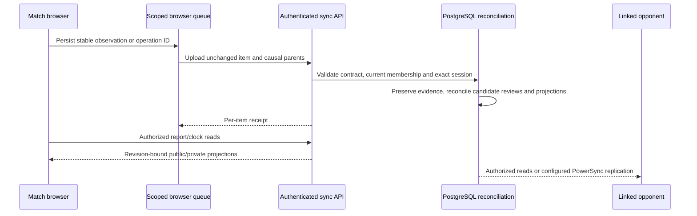

# Application Structure and Request Flow

## Frontend route map

| Audience | Routes | Main implementation areas |
| --- | --- | --- |
| Public | `/`, `/public-dashboard`, `/login`, `/signup`, `/verify-email`, `/oauth/callback`, `/forgot-password`, `/reset-password`, `/email-change/approved`, `/email-change/complete`, `/claim/:token`, `/join-team/:token`, `/join-competition/:token` | Landing/auth, anonymous dashboard and invite/claim resumers. |
| Team member | `/dashboard`, `/competitions`, `/competitions/:id`, `/athletes`, `/events`, `/events/:eventId/confirm-squad`, `/events/:eventId/confirm-squad/opponent`, `/matches/:matchId/live`, `/live-logger`, `/matches/:matchId/report`, `/statistics`, `/injuries`, `/team`; `/tactics` redirects to `/team?section=tactics` | Team shell, competition fixtures, recovery, match-day offline panels and reports. |
| Claimed player | `/player/dashboard`, `/player/team`, `/player/events`, `/player/competitions`, `/player/competitions/:id`; `/player/standings` redirects to `/player/competitions` | Player shell, shared schedule/RSVP and competition views. |

`ProtectedRoute` requires a session. `RequireTeam` and `RequirePlayer` select the applicable experience, but frontend route guards are convenience only; backend guards/services enforce access.

## Backend module map

| Module | Responsibility |
| --- | --- |
| `auth`, `profile` | Better Auth endpoints/session guard and user profile. |
| `teams`, `team-invites`, `claims`, `player` | Membership, coach/assistant invites, player claims and player-facing reads. |
| `athletes` | Active/archive roster and athlete validation. |
| `events`, `weather` | Calendar CRUD, match start, RSVPs, location search and event forecast. |
| `game-plans` | Formations, selection, tactics and role assignments. |
| `matches` | Private sheets/shared sessions, public squad and report projections, event observations/reviews/operations, clock/end/resume, approvals and amendments. |
| `seasons`, `statistics`, `dashboard` | Date windows, aggregates/trends/comparisons, competitions/standings and dashboard summary. |
| `database` | Neon/Drizzle client, journaled SQL functions/triggers, database and protected operations health. |
| `competitions`, `competition-invites` | Shared competition membership, invitations, fixture generation, scheduling responses and results. |
| `injuries` | Injury reports, timeline, protocol and recovery reads. |
| `sync` | Authenticated upload/token/telemetry, public JWKS, idempotent receipts and reconciliation entry points. |
| `public-api` | Public GET routes and their public Swagger contract, bounded dashboard filtering/cache/throttle. |
| `friendly-fixtures` | Registered-team inbound friendly requests, coach accept/decline and paired fixture events. |
| `ai-assistant`, `insights` | Guided draft/confirm/cancel workflows, read-only statistics Q&A, configured match and season narratives. |
| `packages/match-domain` | Shared domain rules/projection logic imported by frontend/backend. |

## Local capture and reconciliation flow

The shared fetch wrapper includes credentials, reports errors and signals successful writes for [automatic refresh](automatic-data-refresh.md). Upload receipt acceptance, pending dependencies, rejected work and replicated state are separate. A repeated stable ID does not create another action; corrected content needs a new authorized operation. The connected REST event path validates the same canonical contracts and service rules.

Linked private sheets share fixture/session authority and sanitize opponent timeline, lineup and geometry. Private tactics, notes, injuries and roster IDs do not cross that boundary. See [collaboration](offline-collaboration.md), [permissions](contracts-and-authorization.md), [API guide](api-guide.md) and [operations](operations/offline-operations-runbook.md).

## Comparison boundaries

- Athlete comparison accepts two or three own-team athlete IDs, optionally within one season.
- Opponent names/results appear in match and athlete history, but no athlete-versus-opponent-player comparison aggregate exists.
- Season trends compare periods within one team's season; there is no cross-team or cross-season side-by-side comparison endpoint.
- Shared competition standings are calculated from completed in-app matches and admin-entered results; older manually entered standings rows remain as a legacy baseline. This is not an athlete-versus-opponent-player comparison feature. See `backend/src/competitions/competitions.service.ts` and `backend/src/common/competition-standings.ts` at the application source revision cited in the [database schema](data/database-schema.md).

Sources: [frontend/src/App.tsx](https://sdp.ms.wits.ac.za/SDP-Interlude/SportCoachingTool/src/commit/f23cbd1c53fbc14dd4579467bcb38f43df0335d0/frontend/src/App.tsx), [backend/src/app.module.ts](https://sdp.ms.wits.ac.za/SDP-Interlude/SportCoachingTool/src/commit/f23cbd1c53fbc14dd4579467bcb38f43df0335d0/backend/src/app.module.ts), [frontend/src/offline/match-store.ts](https://sdp.ms.wits.ac.za/SDP-Interlude/SportCoachingTool/src/commit/f23cbd1c53fbc14dd4579467bcb38f43df0335d0/frontend/src/offline/match-store.ts).

## AI Declaration

OpenAI Codex was used to assist with the preparation, structure and editing of this documentation. The project team remains responsible for verifying the content and reviewing the final document.
