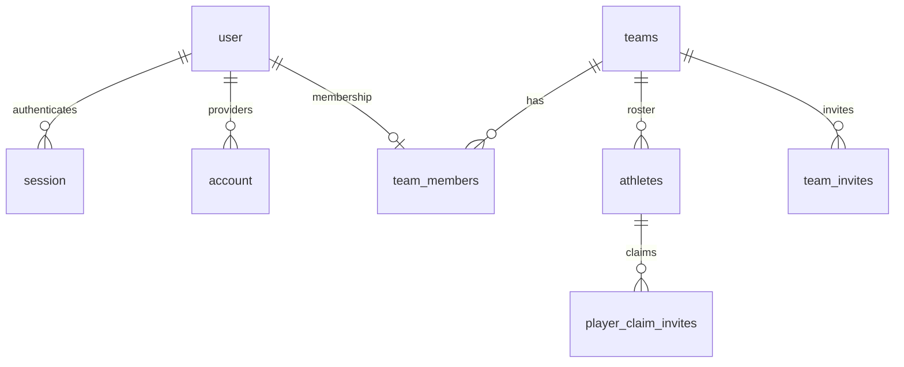
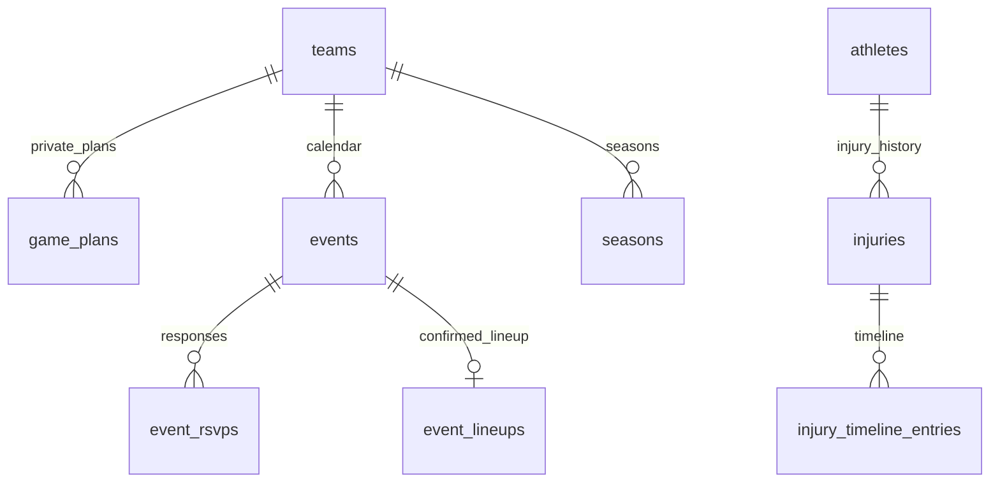
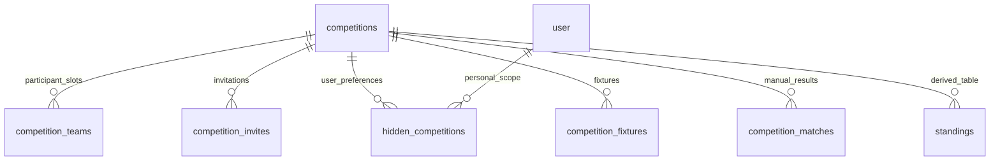
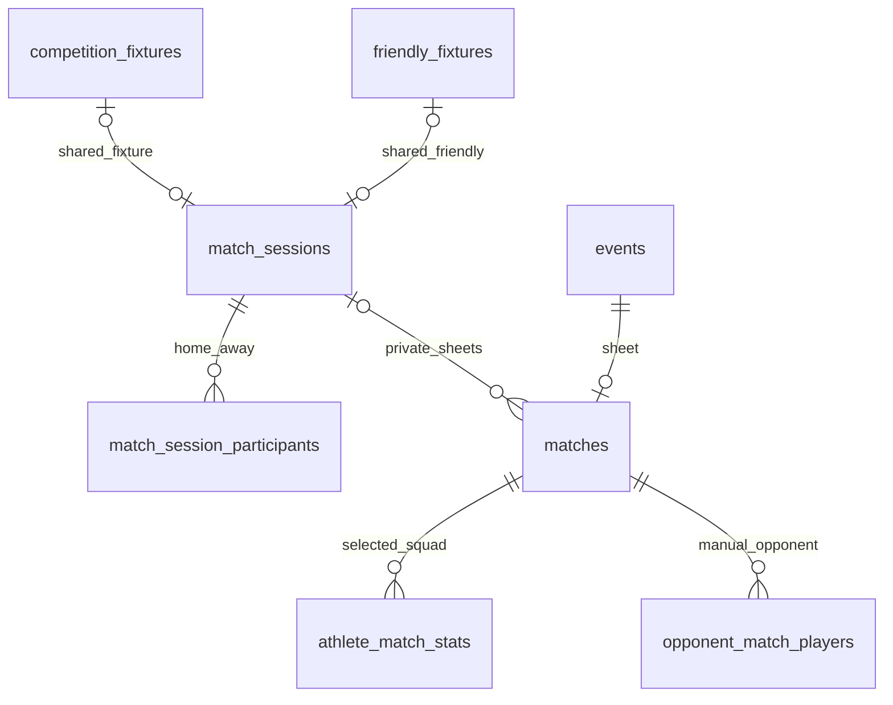
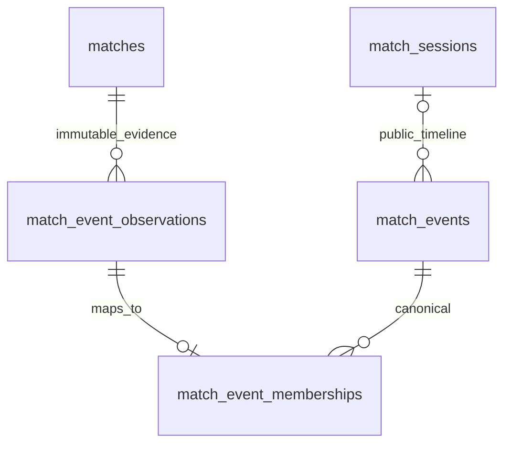
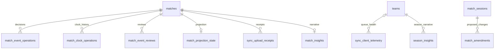

# Current PostgreSQL Database Schema

The current Drizzle declaration contains **42 tables and 29 PostgreSQL enums**. This replaces the older table/enum snapshot as the primary schema description. Columns, typed JSON and declared indexes below come from the inspected source; migration SQL also supplies constraints, functions and triggers that a declaration alone cannot express. See the [source basis](../tech-stack/architecture-overview.md#source-basis).

## Entity relationships

The diagrams group the main relationships for readability; the column inventory gives the complete declared foreign keys, including audit actors and optional links.

### Identity and team scope

### Private planning and injuries

### Competition membership and fixtures

### Shared fixture and private sheets

### Evidence and canonical events

### Operations, projections and publication

## Types and persistence rules

UUIDs identify domain resources, while Better Auth user/session/account identifiers are text. Integer/boolean/text/date/timestamptz/jsonb types are retained below. SQL `date` is a calendar date; timezone-aware timestamps are instants. `schedule_timezone` stores the IANA interpretation for local fixture generation. Nullable columns are marked nullable; PK implies non-null. Shared timestamp spreads supply `created_at` and `updated_at`, both non-null timestamptz with `now()` defaults. JSON shapes are TypeScript persistence annotations, not automatically database-validated schemas.

Team members are coach/assistant; claimed players link through athletes. Membership uniqueness limits a user to one member team, while partial athlete team/user uniqueness permits claims on different teams. Token hashes, not raw invitation tokens, are persisted. Soft athlete archiving preserves references.

## Full table and column inventory

### `user`

Declaration: [user](https://sdp.ms.wits.ac.za/SDP-Interlude/SportCoachingTool/src/commit/f23cbd1c53fbc14dd4579467bcb38f43df0335d0/backend/src/database/schema/index.ts).

| Column | SQL type | Null/default/key and reference |
| --- | --- | --- |
| `id` | `text` | PK |
| `name` | `text` | Non-null |
| `email` | `text` | Non-null; unique |
| `email_verified` | `boolean` | Non-null; default `false` |
| `image` | `text` | Nullable |
| `phone_number` | `text` | Nullable |
| `sex` | `sex` | Nullable |
| `date_of_birth` | `date` | Nullable |
| `created_at`, `updated_at` | timestamptz | Non-null; default `now()` |

### `session`

Declaration: [session](https://sdp.ms.wits.ac.za/SDP-Interlude/SportCoachingTool/src/commit/f23cbd1c53fbc14dd4579467bcb38f43df0335d0/backend/src/database/schema/index.ts).

| Column | SQL type | Null/default/key and reference |
| --- | --- | --- |
| `id` | `text` | PK |
| `expires_at` | `timestamptz` | Non-null |
| `token` | `text` | Non-null; unique |
| `created_at` | `timestamptz` | Non-null; default `now()` |
| `updated_at` | `timestamptz` | Non-null; default `now()` |
| `ip_address` | `text` | Nullable |
| `user_agent` | `text` | Nullable |
| `user_id` | `text` | Non-null; FK → `user.id`; delete cascade |

Declared indexes/constraints (SQL column names in Drizzle notation):

- `index('session_user_id_index').on(user_id)`

### `account`

Declaration: [account](https://sdp.ms.wits.ac.za/SDP-Interlude/SportCoachingTool/src/commit/f23cbd1c53fbc14dd4579467bcb38f43df0335d0/backend/src/database/schema/index.ts).

| Column | SQL type | Null/default/key and reference |
| --- | --- | --- |
| `id` | `text` | PK |
| `account_id` | `text` | Non-null |
| `provider_id` | `text` | Non-null |
| `user_id` | `text` | Non-null; FK → `user.id`; delete cascade |
| `access_token` | `text` | Nullable |
| `refresh_token` | `text` | Nullable |
| `id_token` | `text` | Nullable |
| `access_token_expires_at` | `timestamptz` | Nullable |
| `refresh_token_expires_at` | `timestamptz` | Nullable |
| `scope` | `text` | Nullable |
| `password` | `text` | Nullable |
| `created_at`, `updated_at` | timestamptz | Non-null; default `now()` |

Declared indexes/constraints (SQL column names in Drizzle notation):

- `index('account_user_id_index').on(user_id)`

### `verification`

Declaration: [verification](https://sdp.ms.wits.ac.za/SDP-Interlude/SportCoachingTool/src/commit/f23cbd1c53fbc14dd4579467bcb38f43df0335d0/backend/src/database/schema/index.ts).

| Column | SQL type | Null/default/key and reference |
| --- | --- | --- |
| `id` | `text` | PK |
| `identifier` | `text` | Non-null |
| `value` | `text` | Non-null |
| `expires_at` | `timestamptz` | Non-null |
| `created_at`, `updated_at` | timestamptz | Non-null; default `now()` |

Declared indexes/constraints (SQL column names in Drizzle notation):

- `index('verification_identifier_index').on(identifier)`

### `auth_rate_limits`

Declaration: [auth_rate_limits](https://sdp.ms.wits.ac.za/SDP-Interlude/SportCoachingTool/src/commit/f23cbd1c53fbc14dd4579467bcb38f43df0335d0/backend/src/database/schema/index.ts).

| Column | SQL type | Null/default/key and reference |
| --- | --- | --- |
| `key` | `text` | PK |
| `count` | `integer` | Non-null |
| `window_started_at` | `timestamptz` | Non-null; default `now()` |

### `teams`

Declaration: [teams](https://sdp.ms.wits.ac.za/SDP-Interlude/SportCoachingTool/src/commit/f23cbd1c53fbc14dd4579467bcb38f43df0335d0/backend/src/database/schema/index.ts).

| Column | SQL type | Null/default/key and reference |
| --- | --- | --- |
| `id` | `uuid` | PK; default random UUID |
| `name` | `text` | Non-null |
| `primary_color` | `text` | Nullable |
| `created_at`, `updated_at` | timestamptz | Non-null; default `now()` |

### `match_sessions`

Declaration: [match_sessions](https://sdp.ms.wits.ac.za/SDP-Interlude/SportCoachingTool/src/commit/f23cbd1c53fbc14dd4579467bcb38f43df0335d0/backend/src/database/schema/index.ts).

| Column | SQL type | Null/default/key and reference |
| --- | --- | --- |
| `report_revision` | `integer` | Non-null; default `1` |
| `id` | `uuid` | PK; default random UUID |
| `home_confirmed_at` | `timestamptz` | Nullable |
| `home_confirmed_by_user_id` | `text` | Nullable; FK → `user.id` |
| `away_confirmed_at` | `timestamptz` | Nullable |
| `away_confirmed_by_user_id` | `text` | Nullable; FK → `user.id` |
| `finalised_at` | `timestamptz` | Nullable |
| `finalised_by_user_id` | `text` | Nullable; FK → `user.id` |
| `created_at`, `updated_at` | timestamptz | Non-null; default `now()` |

### `match_session_participants`

Declaration: [match_session_participants](https://sdp.ms.wits.ac.za/SDP-Interlude/SportCoachingTool/src/commit/f23cbd1c53fbc14dd4579467bcb38f43df0335d0/backend/src/database/schema/index.ts).

| Column | SQL type | Null/default/key and reference |
| --- | --- | --- |
| `id` | `uuid` | PK; default random UUID |
| `session_id` | `uuid` | Non-null; FK → `match_sessions.id`; delete cascade |
| `team_id` | `uuid` | Nullable; FK → `teams.id`; delete cascade |
| `competition_team_id` | `uuid` | Nullable; FK → `competition_teams.id`; delete cascade |
| `side` | `match_session_side` | Non-null |
| `confirmation_state` | `match_session_confirmation_state` | Non-null; default `'pending') .notNull(` |
| `created_at`, `updated_at` | timestamptz | Non-null; default `now()` |

Declared indexes/constraints (SQL column names in Drizzle notation):

- `uniqueIndex('match_session_participants_session_side_unique').on( session_id, side, )`
- `index('match_session_participants_team_id_index').on(team_id)`
- `index('match_session_participants_competition_team_id_index').on( competition_team_id, )`
- `check( 'match_session_participants_identity_check', team_id is not null or competition_team_id is not null, )`

### `team_members`

Declaration: [team_members](https://sdp.ms.wits.ac.za/SDP-Interlude/SportCoachingTool/src/commit/f23cbd1c53fbc14dd4579467bcb38f43df0335d0/backend/src/database/schema/index.ts).

| Column | SQL type | Null/default/key and reference |
| --- | --- | --- |
| `id` | `uuid` | PK; default random UUID |
| `team_id` | `uuid` | Non-null; FK → `teams.id`; delete cascade |
| `user_id` | `text` | Non-null; FK → `user.id`; delete cascade |
| `role` | `team_role` | Non-null; default `'assistant'` |
| `created_at`, `updated_at` | timestamptz | Non-null; default `now()` |

Declared indexes/constraints (SQL column names in Drizzle notation):

- `index('team_members_team_id_index').on(team_id)`
- `index('team_members_user_id_index').on(user_id)`
- `uniqueIndex('team_members_user_unique').on(user_id)`
- `uniqueIndex('team_members_team_user_unique').on(team_id, user_id)`

### `athletes`

Declaration: [athletes](https://sdp.ms.wits.ac.za/SDP-Interlude/SportCoachingTool/src/commit/f23cbd1c53fbc14dd4579467bcb38f43df0335d0/backend/src/database/schema/index.ts).

| Column | SQL type | Null/default/key and reference |
| --- | --- | --- |
| `id` | `uuid` | PK; default random UUID |
| `team_id` | `uuid` | Non-null; FK → `teams.id`; delete cascade |
| `first_name` | `text` | Non-null |
| `last_name` | `text` | Non-null |
| `date_of_birth` | `date` | Nullable |
| `position` | `text` | Nullable |
| `squad_number` | `integer` | Nullable |
| `status` | `athlete_status` | Non-null; default `'available'` |
| `archived_at` | `timestamptz` | Nullable |
| `user_id` | `text` | Nullable; FK → `user.id`; delete set null |
| `created_at`, `updated_at` | timestamptz | Non-null; default `now()` |

Declared indexes/constraints (SQL column names in Drizzle notation):

- `index('athletes_team_id_index').on(team_id)`
- `index('athletes_team_name_index').on( team_id, last_name, first_name, )`
- `index('athletes_user_id_index').on(user_id)`
- `uniqueIndex('athletes_team_user_unique') .on(team_id, user_id) .where(user_id is not null)`

### `player_claim_invites`

Declaration: [player_claim_invites](https://sdp.ms.wits.ac.za/SDP-Interlude/SportCoachingTool/src/commit/f23cbd1c53fbc14dd4579467bcb38f43df0335d0/backend/src/database/schema/index.ts).

| Column | SQL type | Null/default/key and reference |
| --- | --- | --- |
| `id` | `uuid` | PK; default random UUID |
| `athlete_id` | `uuid` | Non-null; FK → `athletes.id`; delete cascade |
| `email` | `text` | Non-null |
| `token_hash` | `text` | Non-null; unique |
| `status` | `claim_invite_status` | Non-null; default `'pending'` |
| `created_by_user_id` | `text` | Non-null; FK → `user.id` |
| `expires_at` | `timestamptz` | Non-null |
| `used_at` | `timestamptz` | Nullable |
| `used_by_user_id` | `text` | Nullable; FK → `user.id` |
| `created_at`, `updated_at` | timestamptz | Non-null; default `now()` |

Declared indexes/constraints (SQL column names in Drizzle notation):

- `index('player_claim_invites_athlete_id_index').on(athlete_id)`
- `index('player_claim_invites_token_hash_index').on(token_hash)`

### `team_invites`

Declaration: [team_invites](https://sdp.ms.wits.ac.za/SDP-Interlude/SportCoachingTool/src/commit/f23cbd1c53fbc14dd4579467bcb38f43df0335d0/backend/src/database/schema/index.ts).

| Column | SQL type | Null/default/key and reference |
| --- | --- | --- |
| `id` | `uuid` | PK; default random UUID |
| `team_id` | `uuid` | Non-null; FK → `teams.id`; delete cascade |
| `email` | `text` | Non-null |
| `token_hash` | `text` | Non-null; unique |
| `status` | `team_invite_status` | Non-null; default `'pending'` |
| `created_by_user_id` | `text` | Non-null; FK → `user.id` |
| `expires_at` | `timestamptz` | Non-null |
| `used_at` | `timestamptz` | Nullable |
| `used_by_user_id` | `text` | Nullable; FK → `user.id` |
| `created_at`, `updated_at` | timestamptz | Non-null; default `now()` |

Declared indexes/constraints (SQL column names in Drizzle notation):

- `index('team_invites_team_id_index').on(team_id)`
- `index('team_invites_token_hash_index').on(token_hash)`

### `game_plans`

Declaration: [game_plans](https://sdp.ms.wits.ac.za/SDP-Interlude/SportCoachingTool/src/commit/f23cbd1c53fbc14dd4579467bcb38f43df0335d0/backend/src/database/schema/index.ts).

| Column | SQL type | Null/default/key and reference |
| --- | --- | --- |
| `id` | `uuid` | PK; default random UUID |
| `team_id` | `uuid` | Non-null; FK → `teams.id`; delete cascade |
| `name` | `text` | Non-null |
| `formation_id` | `text` | Non-null; default `'4-3-3'` |
| `assignments` | `jsonb` | Non-null; default `{}) .$type<Record<string, string \| null>>(`; JSON type `Record<string, string \| null>` |
| `custom_positions` | `jsonb` | Nullable; JSON type ` GamePlanFormationPosition[] \| null ` |
| `substitute_ids` | `jsonb` | Non-null; default `[]) .$type<string[]>(`; JSON type `string[]` |
| `defensive_style` | `defensive_style` | Non-null; default `'balanced'` |
| `defensive_width` | `integer` | Non-null; default `5` |
| `defensive_depth` | `integer` | Non-null; default `5` |
| `offensive_style` | `offensive_style` | Non-null; default `'balanced'` |
| `offensive_width` | `integer` | Non-null; default `5` |
| `players_in_box` | `integer` | Non-null; default `4` |
| `corners_commitment` | `integer` | Non-null; default `3` |
| `free_kicks_commitment` | `integer` | Non-null; default `3` |
| `captain_id` | `uuid` | Nullable; FK → `athletes.id`; delete set null |
| `free_kick_taker_id` | `uuid` | Nullable; FK → `athletes.id`; delete set null |
| `long_free_kick_taker_id` | `uuid` | Nullable; FK → `athletes.id`; delete set null |
| `penalty_taker_id` | `uuid` | Nullable; FK → `athletes.id`; delete set null |
| `corner_taker_id` | `uuid` | Nullable; FK → `athletes.id`; delete set null |
| `right_corner_taker_id` | `uuid` | Nullable; FK → `athletes.id`; delete set null |
| `player_instructions` | `jsonb` | Non-null; default `{}) .$type<PlayerInstructionsByAthlete>(`; JSON type `PlayerInstructionsByAthlete` |
| `created_at`, `updated_at` | timestamptz | Non-null; default `now()` |

Declared indexes/constraints (SQL column names in Drizzle notation):

- `index('game_plans_team_id_index').on(team_id)`
- `uniqueIndex('game_plans_team_name_unique').on(team_id, name)`

### `friendly_fixtures`

Declaration: [friendly_fixtures](https://sdp.ms.wits.ac.za/SDP-Interlude/SportCoachingTool/src/commit/f23cbd1c53fbc14dd4579467bcb38f43df0335d0/backend/src/database/schema/index.ts).

| Column | SQL type | Null/default/key and reference |
| --- | --- | --- |
| `id` | `uuid` | PK; default random UUID |
| `requester_team_id` | `uuid` | Non-null; FK → `teams.id`; delete cascade |
| `opponent_team_id` | `uuid` | Non-null; FK → `teams.id`; delete cascade |
| `status` | `friendly_fixture_status` | Non-null; default `'pending'` |
| `created_by_user_id` | `text` | Non-null; FK → `user.id` |
| `responded_by_user_id` | `text` | Nullable; FK → `user.id` |
| `responded_at` | `timestamptz` | Nullable |
| `shared_session_id` | `uuid` | Nullable; FK → `match_sessions.id`; delete set null |
| `created_at`, `updated_at` | timestamptz | Non-null; default `now()` |

Declared indexes/constraints (SQL column names in Drizzle notation):

- `index('friendly_fixtures_requester_team_id_index').on( requester_team_id, )`
- `index('friendly_fixtures_opponent_team_id_index').on(opponent_team_id)`
- `index('friendly_fixtures_opponent_status_index').on( opponent_team_id, status, )`
- `uniqueIndex('friendly_fixtures_shared_session_unique').on( shared_session_id, )`

### `events`

Declaration: [events](https://sdp.ms.wits.ac.za/SDP-Interlude/SportCoachingTool/src/commit/f23cbd1c53fbc14dd4579467bcb38f43df0335d0/backend/src/database/schema/index.ts).

| Column | SQL type | Null/default/key and reference |
| --- | --- | --- |
| `id` | `uuid` | PK; default random UUID |
| `team_id` | `uuid` | Non-null; FK → `teams.id`; delete cascade |
| `title` | `text` | Non-null |
| `type` | `event_type` | Non-null |
| `status` | `event_status` | Non-null; default `'scheduled'` |
| `scheduled_at` | `timestamptz` | Non-null |
| `location` | `text` | Non-null |
| `venue_name` | `text` | Nullable |
| `venue_address` | `text` | Nullable |
| `weather_location` | `text` | Nullable |
| `latitude` | `double precision` | Nullable |
| `longitude` | `double precision` | Nullable |
| `timezone` | `text` | Nullable |
| `notes` | `text` | Nullable |
| `friendly_players_per_side` | `integer` | Nullable |
| `competition_id` | `uuid` | Nullable; FK → `competitions.id`; delete set null |
| `competition_fixture_id` | `uuid` | Nullable |
| `friendly_fixture_id` | `uuid` | Nullable |
| `created_at`, `updated_at` | timestamptz | Non-null; default `now()` |

Declared indexes/constraints (SQL column names in Drizzle notation):

- `index('events_team_id_index').on(team_id)`
- `index('events_team_scheduled_at_index').on(team_id, scheduled_at)`
- `index('events_competition_id_index').on(competition_id)`
- `index('events_competition_fixture_id_index').on(competition_fixture_id)`
- `uniqueIndex('events_team_competition_fixture_unique').on( team_id, competition_fixture_id, )`
- `index('events_friendly_fixture_id_index').on(friendly_fixture_id)`
- `uniqueIndex('events_team_friendly_fixture_unique') .on(team_id, friendly_fixture_id) .where(friendly_fixture_id is not null)`

### `event_rsvps`

Declaration: [event_rsvps](https://sdp.ms.wits.ac.za/SDP-Interlude/SportCoachingTool/src/commit/f23cbd1c53fbc14dd4579467bcb38f43df0335d0/backend/src/database/schema/index.ts).

| Column | SQL type | Null/default/key and reference |
| --- | --- | --- |
| `id` | `uuid` | PK; default random UUID |
| `event_id` | `uuid` | Non-null; FK → `events.id`; delete cascade |
| `athlete_id` | `uuid` | Non-null; FK → `athletes.id`; delete cascade |
| `status` | `rsvp_status` | Non-null |
| `note` | `text` | Nullable |
| `responded_at` | `timestamptz` | Non-null; default `now()` |
| `created_at`, `updated_at` | timestamptz | Non-null; default `now()` |

Declared indexes/constraints (SQL column names in Drizzle notation):

- `index('event_rsvps_event_id_index').on(event_id)`
- `uniqueIndex('event_rsvps_event_athlete_unique').on( event_id, athlete_id, )`

### `event_lineups`

Declaration: [event_lineups](https://sdp.ms.wits.ac.za/SDP-Interlude/SportCoachingTool/src/commit/f23cbd1c53fbc14dd4579467bcb38f43df0335d0/backend/src/database/schema/index.ts).

| Column | SQL type | Null/default/key and reference |
| --- | --- | --- |
| `id` | `uuid` | PK; default random UUID |
| `event_id` | `uuid` | Non-null; unique; FK → `events.id`; delete cascade |
| `team_id` | `uuid` | Non-null; FK → `teams.id`; delete cascade |
| `starting_athlete_ids` | `jsonb` | Non-null; JSON type `string[]` |
| `bench_athlete_ids` | `jsonb` | Non-null; JSON type `string[]` |
| `formation_id` | `text` | Nullable |
| `pitch_assignments` | `jsonb` | Nullable; JSON type `Record<string, string \| null>` |
| `custom_positions` | `jsonb` | Nullable; JSON type ` GamePlanFormationPosition[] \| null ` |
| `confirmed_by_user_id` | `text` | Non-null; FK → `user.id` |
| `confirmed_at` | `timestamptz` | Non-null |
| `created_at`, `updated_at` | timestamptz | Non-null; default `now()` |

Declared indexes/constraints (SQL column names in Drizzle notation):

- `index('event_lineups_team_id_index').on(team_id)`

### `seasons`

Declaration: [seasons](https://sdp.ms.wits.ac.za/SDP-Interlude/SportCoachingTool/src/commit/f23cbd1c53fbc14dd4579467bcb38f43df0335d0/backend/src/database/schema/index.ts).

| Column | SQL type | Null/default/key and reference |
| --- | --- | --- |
| `id` | `uuid` | PK; default random UUID |
| `team_id` | `uuid` | Non-null; FK → `teams.id`; delete cascade |
| `name` | `text` | Non-null |
| `start_date` | `date` | Non-null |
| `end_date` | `date` | Non-null |
| `is_current` | `boolean` | Non-null; default `false` |
| `created_at`, `updated_at` | timestamptz | Non-null; default `now()` |

Declared indexes/constraints (SQL column names in Drizzle notation):

- `index('seasons_team_id_index').on(team_id)`
- `index('seasons_team_start_date_index').on(team_id, start_date)`
- `uniqueIndex('seasons_team_name_unique').on(team_id, name)`
- `uniqueIndex('seasons_team_current_unique') .on(team_id) .where(is_current)`

### `competitions`

Declaration: [competitions](https://sdp.ms.wits.ac.za/SDP-Interlude/SportCoachingTool/src/commit/f23cbd1c53fbc14dd4579467bcb38f43df0335d0/backend/src/database/schema/index.ts).

| Column | SQL type | Null/default/key and reference |
| --- | --- | --- |
| `id` | `uuid` | PK; default random UUID |
| `team_id` | `uuid` | Non-null; FK → `teams.id`; delete cascade |
| `name` | `text` | Non-null |
| `type` | `competition_type` | Non-null |
| `season_id` | `uuid` | Nullable; FK → `seasons.id`; delete set null |
| `season` | `text` | Nullable |
| `admin_user_id` | `text` | Nullable; FK → `user.id`; delete set null |
| `archived_at` | `timestamptz` | Nullable |
| `format` | `competition_format` | Nullable |
| `configured_team_count` | `integer` | Nullable |
| `players_per_side` | `integer` | Non-null; default `11` |
| `max_substitutes` | `integer` | Non-null; default `5` |
| `red_card_suspension_matches` | `integer` | Non-null; default `1) .notNull(` |
| `accumulated_yellow_threshold` | `integer` | Non-null; default `5) .notNull(` |
| `yellow_suspension_matches` | `integer` | Non-null; default `1) .notNull(` |
| `start_date` | `date` | Nullable |
| `schedule_timezone` | `text` | Non-null; default `'UTC'` |
| `allowed_playing_days` | `integer` | Non-null; default `sql`ARRAY[6]::integer[]`) .notNull(` |
| `default_kickoff_time` | `text` | Non-null; default `'15:00'` |
| `fixtures_per_opponent` | `integer` | Non-null; default `1` |
| `points_win` | `integer` | Non-null; default `3` |
| `points_draw` | `integer` | Non-null; default `1` |
| `points_loss` | `integer` | Non-null; default `0` |
| `qualifier_count` | `integer` | Nullable |
| `result_tracking_started_at` | `timestamptz` | Non-null; default `now()` |
| `created_at`, `updated_at` | timestamptz | Non-null; default `now()` |

Declared indexes/constraints (SQL column names in Drizzle notation):

- `check( 'competitions_settings_valid',  (configured_team_count is null or configured_team_count between 2 and 128) and players_per_side in (5,7,11) and max_substitutes between 0 and 99 and red_card_suspension_matches between 0 and 99 and accumulated_yellow_threshold between 1 and 99 and yellow_suspension_matches between 0 and 99 and cardinality(allowed_playing_days) between 1 and 7 and allowed_playing_days <@ ARRAY[0,1,2,3,4,5,6]::integer[] and array_position(allowed_playing_days, null) is null and default_kickoff_time ~ '^([01][0-9]\|2[0-3]):[0-5][0-9]$' and fixtures_per_opponent in (1,2) and points_win between 0 and 99 and points_draw between 0 and 99 and points_loss between 0 and 99 and (format is null or (type = 'league' and format = 'league') or (type = 'cup' and format in ('knockout','league_knockout'))) and (format is distinct from 'knockout' or configured_team_count is null or configured_team_count in (4,8,16,32)) and (qualifier_count is null or (format is not null and format = 'league_knockout' and qualifier_count in (4,8,16,32) and configured_team_count is not null and qualifier_count <= configured_team_count)) , )`
- `index('competitions_team_id_index').on(team_id)`
- `index('competitions_season_id_index').on(season_id)`
- `index('competitions_admin_user_id_index').on(admin_user_id)`
- `uniqueIndex('competitions_name_lower_unique').on(lower(name))`

### `hidden_competitions`

Declaration: [hidden_competitions](https://sdp.ms.wits.ac.za/SDP-Interlude/SportCoachingTool/src/commit/f23cbd1c53fbc14dd4579467bcb38f43df0335d0/backend/src/database/schema/index.ts).

| Column | SQL type | Null/default/key and reference |
| --- | --- | --- |
| `user_id` | `text` | Non-null; FK → `user.id`; delete cascade |
| `competition_id` | `uuid` | Non-null; FK → `competitions.id`; delete cascade |

Declared indexes/constraints (SQL column names in Drizzle notation):

- `primaryKey({ columns: [user_id, competition_id] })`

### `competition_teams`

Declaration: [competition_teams](https://sdp.ms.wits.ac.za/SDP-Interlude/SportCoachingTool/src/commit/f23cbd1c53fbc14dd4579467bcb38f43df0335d0/backend/src/database/schema/index.ts).

| Column | SQL type | Null/default/key and reference |
| --- | --- | --- |
| `id` | `uuid` | PK; default random UUID |
| `competition_id` | `uuid` | Non-null; FK → `competitions.id`; delete cascade |
| `team_id` | `uuid` | Nullable; FK → `teams.id`; delete set null |
| `display_name` | `text` | Non-null |
| `original_display_name` | `text` | Nullable |
| `created_at`, `updated_at` | timestamptz | Non-null; default `now()` |

Declared indexes/constraints (SQL column names in Drizzle notation):

- `uniqueIndex('competition_teams_competition_id_id_unique').on( competition_id, id, )`
- `index('competition_teams_competition_id_index').on(competition_id)`
- `index('competition_teams_team_id_index').on(team_id)`
- `uniqueIndex('competition_teams_competition_team_unique') .on(competition_id, team_id) .where(team_id is not null)`
- `uniqueIndex('competition_teams_competition_display_name_unique').on( competition_id, lower(display_name), )`

### `competition_invites`

Declaration: [competition_invites](https://sdp.ms.wits.ac.za/SDP-Interlude/SportCoachingTool/src/commit/f23cbd1c53fbc14dd4579467bcb38f43df0335d0/backend/src/database/schema/index.ts).

| Column | SQL type | Null/default/key and reference |
| --- | --- | --- |
| `id` | `uuid` | PK; default random UUID |
| `competition_id` | `uuid` | Non-null; FK → `competitions.id`; delete cascade |
| `competition_team_id` | `uuid` | Non-null; FK → `competition_teams.id`; delete cascade |
| `email` | `text` | Non-null |
| `token_hash` | `text` | Non-null; unique |
| `status` | `competition_invite_status` | Non-null; default `'pending'` |
| `created_by_user_id` | `text` | Non-null; FK → `user.id` |
| `expires_at` | `timestamptz` | Non-null |
| `used_at` | `timestamptz` | Nullable |
| `used_by_user_id` | `text` | Nullable; FK → `user.id` |
| `proposed_name` | `text` | Nullable |
| `proposed_team_id` | `uuid` | Nullable; FK → `teams.id` |
| `requested_by_user_id` | `text` | Nullable; FK → `user.id` |
| `created_at`, `updated_at` | timestamptz | Non-null; default `now()` |

Declared indexes/constraints (SQL column names in Drizzle notation):

- `index('competition_invites_competition_id_index').on(competition_id)`
- `uniqueIndex('competition_invites_pending_slot_unique') .on(competition_team_id) .where(status in ('pending', 'verification'))`
- `uniqueIndex('competition_invites_verification_team_unique') .on(competition_id, proposed_team_id) .where( status = 'verification' and proposed_team_id is not null, )`
- `uniqueIndex('competition_invites_verification_user_unique') .on(competition_id, requested_by_user_id) .where(status = 'verification')`

### `matches`

Declaration: [matches](https://sdp.ms.wits.ac.za/SDP-Interlude/SportCoachingTool/src/commit/f23cbd1c53fbc14dd4579467bcb38f43df0335d0/backend/src/database/schema/index.ts).

| Column | SQL type | Null/default/key and reference |
| --- | --- | --- |
| `id` | `uuid` | PK; default random UUID |
| `event_id` | `uuid` | Non-null; unique; FK → `events.id`; delete cascade |
| `shared_match_id` | `uuid` | Nullable; FK → `match_sessions.id`; delete set null |
| `competition_id` | `uuid` | Nullable; FK → `competitions.id`; delete set null |
| `opponent_competition_team_id` | `uuid` | Nullable; FK → `competition_teams.id`; delete set null |
| `opponent_team_id` | `uuid` | Nullable; FK → `teams.id`; delete set null |
| `opponent_name` | `text` | Non-null |
| `is_home` | `boolean` | Non-null; default `true` |
| `team_score` | `integer` | Non-null; default `0` |
| `opponent_score` | `integer` | Non-null; default `0` |
| `game_plan_id` | `uuid` | Nullable; FK → `game_plans.id`; delete set null |
| `game_plan_snapshot` | `jsonb` | Nullable; JSON type `GamePlanSnapshot` |
| `opponent_squad_visibility` | `opponent_squad_visibility` | Non-null; default `'none') .notNull(` |
| `team_color` | `text` | Nullable |
| `opponent_color` | `text` | Nullable |
| `clock_period` | `text` | Non-null; default `'not_started'` |
| `clock_elapsed_ms` | `integer` | Non-null; default `0` |
| `clock_started_at` | `timestamptz` | Nullable |
| `clock_revision` | `integer` | Non-null; default `0` |
| `created_at`, `updated_at` | timestamptz | Non-null; default `now()` |

Declared indexes/constraints (SQL column names in Drizzle notation):

- `index('matches_competition_id_index').on(competition_id)`
- `index('matches_opponent_competition_team_id_index').on( opponent_competition_team_id, )`
- `index('matches_opponent_team_id_index').on(opponent_team_id)`
- `index('matches_game_plan_id_index').on(game_plan_id)`
- `index('matches_shared_match_id_index').on(shared_match_id)`

### `competition_matches`

Declaration: [competition_matches](https://sdp.ms.wits.ac.za/SDP-Interlude/SportCoachingTool/src/commit/f23cbd1c53fbc14dd4579467bcb38f43df0335d0/backend/src/database/schema/index.ts).

| Column | SQL type | Null/default/key and reference |
| --- | --- | --- |
| `id` | `uuid` | PK; default random UUID |
| `competition_id` | `uuid` | Non-null; FK → `competitions.id`; delete cascade |
| `home_competition_team_id` | `uuid` | Non-null; FK → `competition_teams.id`; delete cascade |
| `away_competition_team_id` | `uuid` | Non-null; FK → `competition_teams.id`; delete cascade |
| `home_score` | `integer` | Non-null; default `0` |
| `away_score` | `integer` | Non-null; default `0` |
| `played_at` | `timestamptz` | Non-null |
| `created_by_user_id` | `text` | Non-null; FK → `user.id` |
| `created_at`, `updated_at` | timestamptz | Non-null; default `now()` |

Declared indexes/constraints (SQL column names in Drizzle notation):

- `index('competition_matches_competition_id_index').on(competition_id)`
- `index('competition_matches_home_team_id_index').on( home_competition_team_id, )`
- `index('competition_matches_away_team_id_index').on( away_competition_team_id, )`

### `opponent_match_players`

Declaration: [opponent_match_players](https://sdp.ms.wits.ac.za/SDP-Interlude/SportCoachingTool/src/commit/f23cbd1c53fbc14dd4579467bcb38f43df0335d0/backend/src/database/schema/index.ts).

| Column | SQL type | Null/default/key and reference |
| --- | --- | --- |
| `id` | `uuid` | PK; default random UUID |
| `match_id` | `uuid` | Non-null; FK → `matches.id`; delete cascade |
| `shirt_number` | `integer` | Non-null |
| `name` | `text` | Nullable |
| `position` | `text` | Nullable |
| `created_at`, `updated_at` | timestamptz | Non-null; default `now()` |

Declared indexes/constraints (SQL column names in Drizzle notation):

- `index('opponent_match_players_match_id_index').on(match_id)`
- `uniqueIndex('opponent_match_players_match_number_unique').on( match_id, shirt_number, )`

### `athlete_match_stats`

Declaration: [athlete_match_stats](https://sdp.ms.wits.ac.za/SDP-Interlude/SportCoachingTool/src/commit/f23cbd1c53fbc14dd4579467bcb38f43df0335d0/backend/src/database/schema/index.ts).

| Column | SQL type | Null/default/key and reference |
| --- | --- | --- |
| `id` | `uuid` | PK; default random UUID |
| `match_id` | `uuid` | Non-null; FK → `matches.id`; delete cascade |
| `athlete_id` | `uuid` | Non-null; FK → `athletes.id`; delete cascade |
| `started` | `boolean` | Non-null; default `true` |
| `minutes_played` | `integer` | Nullable |
| `goals` | `integer` | Non-null; default `0` |
| `assists` | `integer` | Non-null; default `0` |
| `yellow_cards` | `integer` | Non-null; default `0` |
| `red_cards` | `integer` | Non-null; default `0` |
| `created_at`, `updated_at` | timestamptz | Non-null; default `now()` |

Declared indexes/constraints (SQL column names in Drizzle notation):

- `index('athlete_match_stats_athlete_id_index').on(athlete_id)`
- `uniqueIndex('athlete_match_stats_match_athlete_unique').on( match_id, athlete_id, )`

### `standings`

Declaration: [standings](https://sdp.ms.wits.ac.za/SDP-Interlude/SportCoachingTool/src/commit/f23cbd1c53fbc14dd4579467bcb38f43df0335d0/backend/src/database/schema/index.ts).

| Column | SQL type | Null/default/key and reference |
| --- | --- | --- |
| `id` | `uuid` | PK; default random UUID |
| `competition_id` | `uuid` | Non-null; FK → `competitions.id`; delete cascade |
| `team_name` | `text` | Non-null |
| `position` | `integer` | Non-null |
| `played` | `integer` | Non-null; default `0` |
| `won` | `integer` | Non-null; default `0` |
| `drawn` | `integer` | Non-null; default `0` |
| `lost` | `integer` | Non-null; default `0` |
| `goals_for` | `integer` | Non-null; default `0` |
| `goals_against` | `integer` | Non-null; default `0` |
| `points` | `integer` | Non-null; default `0` |
| `is_own_team` | `boolean` | Non-null; default `false` |
| `created_at`, `updated_at` | timestamptz | Non-null; default `now()` |

Declared indexes/constraints (SQL column names in Drizzle notation):

- `index('standings_competition_id_index').on(competition_id)`
- `uniqueIndex('standings_competition_position_unique').on( competition_id, position, )`
- `uniqueIndex('standings_competition_team_name_unique').on( competition_id, team_name, )`

### `match_events`

Declaration: [match_events](https://sdp.ms.wits.ac.za/SDP-Interlude/SportCoachingTool/src/commit/f23cbd1c53fbc14dd4579467bcb38f43df0335d0/backend/src/database/schema/index.ts).

| Column | SQL type | Null/default/key and reference |
| --- | --- | --- |
| `id` | `uuid` | PK; default random UUID |
| `match_id` | `uuid` | Non-null; FK → `matches.id`; delete cascade |
| `session_id` | `uuid` | Nullable; FK → `match_sessions.id`; delete set null |
| `side` | `match_session_side` | Nullable |
| `athlete_id` | `uuid` | Nullable; FK → `athletes.id`; delete set null |
| `team` | `match_event_team` | Non-null |
| `opponent_label` | `text` | Nullable |
| `opponent_player_id` | `uuid` | Nullable; FK → `opponent_match_players.id`; delete set null |
| `event_type` | `match_event_type` | Non-null |
| `minute` | `integer` | Non-null |
| `detail` | `text` | Nullable |
| `logged_by_user_id` | `text` | Non-null; FK → `user.id` |
| `manually_adjusted` | `boolean` | Non-null; default `false` |
| `client_request_id` | `uuid` | Nullable |
| `period` | `text` | Non-null; default `'not_started'` |
| `match_elapsed_ms` | `integer` | Nullable |
| `structured_payload` | `jsonb` | Nullable; JSON type `Record<string, unknown>` |
| `lifecycle_status` | `text` | Non-null; default `'provisional'` |
| `rules_version` | `integer` | Non-null; default `1` |
| `projection_revision` | `integer` | Non-null; default `0` |
| `created_at`, `updated_at` | timestamptz | Non-null; default `now()` |

Declared indexes/constraints (SQL column names in Drizzle notation):

- `index('match_events_match_id_index').on(match_id)`
- `index('match_events_session_side_index').on( session_id, side, period, match_elapsed_ms, )`
- `index('match_events_opponent_player_id_index').on(opponent_player_id)`
- `index('match_events_match_athlete_type_index').on( match_id, athlete_id, event_type, )`
- `uniqueIndex('match_events_match_request_unique') .on(match_id, client_request_id) .where(client_request_id is not null)`

### `injuries`

Declaration: [injuries](https://sdp.ms.wits.ac.za/SDP-Interlude/SportCoachingTool/src/commit/f23cbd1c53fbc14dd4579467bcb38f43df0335d0/backend/src/database/schema/index.ts).

| Column | SQL type | Null/default/key and reference |
| --- | --- | --- |
| `id` | `uuid` | PK; default random UUID |
| `team_id` | `uuid` | Non-null; FK → `teams.id`; delete cascade |
| `athlete_id` | `uuid` | Non-null; FK → `athletes.id`; delete cascade |
| `body_region` | `injury_body_region` | Non-null |
| `injury_type` | `injury_type` | Non-null |
| `severity` | `injury_severity` | Non-null |
| `status` | `injury_status` | Non-null; default `'reported'` |
| `context` | `injury_context` | Non-null; default `'other'` |
| `occurred_on` | `date` | Non-null |
| `match_id` | `uuid` | Nullable; FK → `matches.id`; delete set null |
| `match_event_id` | `uuid` | Nullable; FK → `match_events.id`; delete set null |
| `minute` | `integer` | Nullable |
| `estimated_return_min_days` | `integer` | Non-null |
| `estimated_return_max_days` | `integer` | Non-null |
| `estimated_return_from` | `date` | Non-null |
| `estimated_return_to` | `date` | Non-null |
| `actual_return_on` | `date` | Nullable |
| `diagnosed_by` | `text` | Nullable |
| `description` | `text` | Nullable |
| `notes` | `text` | Nullable |
| `rehab_phases` | `jsonb` | Nullable |
| `closed_at` | `timestamptz` | Nullable |
| `created_by_user_id` | `text` | Non-null; FK → `user.id` |
| `created_at`, `updated_at` | timestamptz | Non-null; default `now()` |

Declared indexes/constraints (SQL column names in Drizzle notation):

- `index('injuries_team_id_index').on(team_id)`
- `index('injuries_athlete_id_index').on(athlete_id)`
- `index('injuries_team_status_index').on(team_id, status)`
- `index('injuries_athlete_region_index').on( athlete_id, body_region, )`
- `uniqueIndex('injuries_match_event_unique') .on(match_event_id) .where(match_event_id is not null)`

### `injury_timeline_entries`

Declaration: [injury_timeline_entries](https://sdp.ms.wits.ac.za/SDP-Interlude/SportCoachingTool/src/commit/f23cbd1c53fbc14dd4579467bcb38f43df0335d0/backend/src/database/schema/index.ts).

| Column | SQL type | Null/default/key and reference |
| --- | --- | --- |
| `id` | `uuid` | PK; default random UUID |
| `injury_id` | `uuid` | Non-null; FK → `injuries.id`; delete cascade |
| `kind` | `injury_timeline_kind` | Non-null |
| `occurred_on` | `date` | Non-null |
| `title` | `text` | Non-null |
| `detail` | `text` | Nullable |
| `created_by_user_id` | `text` | Non-null; FK → `user.id` |
| `created_at`, `updated_at` | timestamptz | Non-null; default `now()` |

Declared indexes/constraints (SQL column names in Drizzle notation):

- `index('injury_timeline_entries_injury_index').on( injury_id, occurred_on, )`

### `match_event_observations`

Declaration: [match_event_observations](https://sdp.ms.wits.ac.za/SDP-Interlude/SportCoachingTool/src/commit/f23cbd1c53fbc14dd4579467bcb38f43df0335d0/backend/src/database/schema/index.ts).

| Column | SQL type | Null/default/key and reference |
| --- | --- | --- |
| `id` | `uuid` | PK |
| `match_id` | `uuid` | Non-null; FK → `matches.id`; delete cascade |
| `session_id` | `uuid` | Nullable; FK → `match_sessions.id`; delete set null |
| `side` | `match_session_side` | Nullable |
| `device_id` | `uuid` | Non-null |
| `logged_by_user_id` | `text` | Non-null; FK → `user.id` |
| `schema_version` | `integer` | Non-null; default `1` |
| `event_type` | `match_event_type` | Non-null |
| `team` | `match_event_team` | Non-null |
| `athlete_id` | `uuid` | Nullable; FK → `athletes.id`; delete set null |
| `opponent_label` | `text` | Nullable |
| `opponent_player_id` | `uuid` | Nullable; FK → `opponent_match_players.id`; delete set null |
| `period` | `text` | Non-null |
| `match_elapsed_ms` | `integer` | Non-null |
| `payload` | `jsonb` | Non-null; JSON type `Record<string, unknown>` |
| `payload_hash` | `text` | Non-null |
| `client_created_at` | `timestamptz` | Non-null |
| `server_received_at` | `timestamptz` | Non-null; default `now()` |

Declared indexes/constraints (SQL column names in Drizzle notation):

- `index('match_event_observations_match_index').on( match_id, period, match_elapsed_ms, )`
- `index('match_event_observations_session_side_index').on( session_id, side, period, match_elapsed_ms, )`
- `index('match_event_observations_actor_index').on(logged_by_user_id)`

### `match_event_memberships`

Declaration: [match_event_memberships](https://sdp.ms.wits.ac.za/SDP-Interlude/SportCoachingTool/src/commit/f23cbd1c53fbc14dd4579467bcb38f43df0335d0/backend/src/database/schema/index.ts).

| Column | SQL type | Null/default/key and reference |
| --- | --- | --- |
| `observation_id` | `uuid` | PK; FK → `match_event_observations.id`; delete cascade |
| `canonical_event_id` | `uuid` | Non-null; FK → `match_events.id`; delete cascade |
| `projection_revision` | `integer` | Non-null; default `0` |
| `created_at` | `timestamptz` | Non-null; default `now()` |

Declared indexes/constraints (SQL column names in Drizzle notation):

- `index('match_event_memberships_canonical_index').on(canonical_event_id)`

### `match_event_operations`

Declaration: [match_event_operations](https://sdp.ms.wits.ac.za/SDP-Interlude/SportCoachingTool/src/commit/f23cbd1c53fbc14dd4579467bcb38f43df0335d0/backend/src/database/schema/index.ts).

| Column | SQL type | Null/default/key and reference |
| --- | --- | --- |
| `id` | `uuid` | PK |
| `match_id` | `uuid` | Non-null; FK → `matches.id`; delete cascade |
| `session_id` | `uuid` | Nullable; FK → `match_sessions.id`; delete set null |
| `actor_user_id` | `text` | Non-null; FK → `user.id` |
| `operation_type` | `text` | Non-null |
| `target_observation_ids` | `jsonb` | Non-null; default `[]) .notNull(`; JSON type `string[]` |
| `canonical_event_id` | `uuid` | Nullable; FK → `match_events.id`; delete set null |
| `public_canonical_event` | `boolean` | Non-null; default `false) .notNull(` |
| `causal_parent_ids` | `jsonb` | Non-null; default `[]) .notNull(`; JSON type `string[]` |
| `decision` | `jsonb` | Non-null; JSON type `Record<string, unknown>` |
| `reason` | `text` | Nullable |
| `schema_version` | `integer` | Non-null; default `1` |
| `created_at` | `timestamptz` | Non-null; default `now()` |

Declared indexes/constraints (SQL column names in Drizzle notation):

- `index('match_event_operations_match_index').on( match_id, created_at, )`
- `index('match_event_operations_actor_index').on(actor_user_id)`
- `index('match_event_operations_session_index').on( session_id, created_at, )`
- `index('match_event_operations_canonical_index').on(canonical_event_id)`

### `match_clock_operations`

Declaration: [match_clock_operations](https://sdp.ms.wits.ac.za/SDP-Interlude/SportCoachingTool/src/commit/f23cbd1c53fbc14dd4579467bcb38f43df0335d0/backend/src/database/schema/index.ts).

| Column | SQL type | Null/default/key and reference |
| --- | --- | --- |
| `id` | `uuid` | PK |
| `match_id` | `uuid` | Non-null; FK → `matches.id`; delete cascade |
| `session_id` | `uuid` | Nullable; FK → `match_sessions.id`; delete set null |
| `actor_user_id` | `text` | Non-null; FK → `user.id` |
| `period` | `text` | Non-null |
| `elapsed_ms` | `integer` | Non-null |
| `running` | `boolean` | Non-null |
| `base_revision` | `integer` | Non-null |
| `applied_revision` | `integer` | Non-null |
| `outcome` | `text` | Non-null |
| `payload_hash` | `text` | Non-null |
| `client_created_at` | `timestamptz` | Non-null |
| `created_at` | `timestamptz` | Non-null; default `now()` |

Declared indexes/constraints (SQL column names in Drizzle notation):

- `index('match_clock_operations_match_revision_index').on( match_id, applied_revision, )`
- `index('match_clock_operations_actor_index').on(actor_user_id)`
- `index('match_clock_operations_session_index').on( session_id, applied_revision, )`

### `match_event_reviews`

Declaration: [match_event_reviews](https://sdp.ms.wits.ac.za/SDP-Interlude/SportCoachingTool/src/commit/f23cbd1c53fbc14dd4579467bcb38f43df0335d0/backend/src/database/schema/index.ts).

| Column | SQL type | Null/default/key and reference |
| --- | --- | --- |
| `team_decision_notes` | `jsonb` | Non-null; default `{}) .notNull(`; JSON type `Record<string, string \| null>` |
| `team_decisions` | `jsonb` | Non-null; default `{}) .notNull(`; JSON type `Record<string, string>` |
| `id` | `uuid` | PK; default random UUID |
| `match_id` | `uuid` | Non-null; FK → `matches.id`; delete cascade |
| `session_id` | `uuid` | Nullable; FK → `match_sessions.id`; delete set null |
| `canonical_event_id` | `uuid` | Non-null; FK → `match_events.id`; delete cascade |
| `public_canonical_event` | `boolean` | Non-null; default `false) .notNull(` |
| `observation_ids` | `jsonb` | Non-null; default `[]) .notNull(`; JSON type `string[]` |
| `review_version` | `integer` | Non-null; default `1` |
| `reason` | `text` | Non-null |
| `status` | `text` | Non-null; default `'open'` |
| `resolution` | `text` | Nullable |
| `resolved_by_user_id` | `text` | Nullable; FK → `user.id` |
| `resolved_at` | `timestamptz` | Nullable |
| `disputed_by_user_id` | `text` | Nullable; FK → `user.id` |
| `disputed_at` | `timestamptz` | Nullable |
| `created_at`, `updated_at` | timestamptz | Non-null; default `now()` |

Declared indexes/constraints (SQL column names in Drizzle notation):

- `index('match_event_reviews_match_status_index').on( match_id, status, )`
- `index('match_event_reviews_session_status_index').on( session_id, status, )`
- `index('match_event_reviews_canonical_index').on(canonical_event_id)`

### `competition_fixtures`

Declaration: [competition_fixtures](https://sdp.ms.wits.ac.za/SDP-Interlude/SportCoachingTool/src/commit/f23cbd1c53fbc14dd4579467bcb38f43df0335d0/backend/src/database/schema/index.ts).

| Column | SQL type | Null/default/key and reference |
| --- | --- | --- |
| `id` | `uuid` | PK; default random UUID |
| `competition_id` | `uuid` | Non-null; FK → `competitions.id`; delete cascade |
| `stage` | `competition_fixture_stage` | Non-null |
| `round` | `integer` | Non-null |
| `position` | `integer` | Non-null |
| `home_competition_team_id` | `uuid` | Nullable |
| `away_competition_team_id` | `uuid` | Nullable |
| `scheduled_at` | `timestamptz` | Non-null |
| `status` | `competition_fixture_status` | Non-null; default `'scheduled'` |
| `home_score` | `integer` | Nullable |
| `away_score` | `integer` | Nullable |
| `home_penalty_score` | `integer` | Nullable |
| `away_penalty_score` | `integer` | Nullable |
| `winner_competition_team_id` | `uuid` | Nullable |
| `next_fixture_id` | `uuid` | Nullable |
| `next_fixture_slot` | `text` | Nullable |
| `linked_match_id` | `uuid` | Nullable; FK → `matches.id` |
| `shared_session_id` | `uuid` | Nullable; FK → `match_sessions.id`; delete set null |
| `legacy_result_id` | `uuid` | Nullable; FK → `competition_matches.id` |
| `schedule_revision` | `integer` | Non-null; default `1` |
| `home_schedule_response` | `competition_fixture_schedule_response` | Non-null; default `'pending') .notNull(` |
| `away_schedule_response` | `competition_fixture_schedule_response` | Non-null; default `'pending') .notNull(` |
| `home_schedule_responded_at` | `timestamptz` | Nullable |
| `away_schedule_responded_at` | `timestamptz` | Nullable |
| `home_schedule_responded_by_user_id` | `text` | Nullable |
| `away_schedule_responded_by_user_id` | `text` | Nullable |
| `schedule_proposed_by_competition_team_id` | `uuid` | Nullable |
| `schedule_proposal_note` | `text` | Nullable |
| `schedule_confirmed_at` | `timestamptz` | Nullable |
| `created_at`, `updated_at` | timestamptz | Non-null; default `now()` |

Declared indexes/constraints (SQL column names in Drizzle notation):

- `uniqueIndex('competition_fixtures_competition_id_id_unique').on( competition_id, id, )`
- `uniqueIndex('competition_fixtures_round_position_unique').on( competition_id, stage, round, position, )`
- `uniqueIndex('competition_fixtures_pair_unique').on( competition_id, stage, home_competition_team_id, away_competition_team_id, )`
- `uniqueIndex('competition_fixtures_next_slot_unique').on( next_fixture_id, next_fixture_slot, )`
- `uniqueIndex('competition_fixtures_linked_match_unique').on( linked_match_id, )`
- `uniqueIndex('competition_fixtures_shared_session_unique').on( shared_session_id, )`
- `uniqueIndex('competition_fixtures_legacy_result_unique').on( legacy_result_id, )`
- `foreignKey({ name: 'competition_fixtures_home_participant_fk', columns: [competition_id, home_competition_team_id], foreignColumns: [competition_teams.competition_id, competition_teams.id], })`
- `foreignKey({ name: 'competition_fixtures_away_participant_fk', columns: [competition_id, away_competition_team_id], foreignColumns: [competition_teams.competition_id, competition_teams.id], })`
- `foreignKey({ name: 'competition_fixtures_winner_participant_fk', columns: [competition_id, winner_competition_team_id], foreignColumns: [competition_teams.competition_id, competition_teams.id], })`
- `foreignKey({ name: 'competition_fixtures_home_schedule_user_fk', columns: [home_schedule_responded_by_user_id], foreignColumns: [user.id], }).onDelete('set null')`
- `foreignKey({ name: 'competition_fixtures_away_schedule_user_fk', columns: [away_schedule_responded_by_user_id], foreignColumns: [user.id], }).onDelete('set null')`
- `foreignKey({ name: 'competition_fixtures_schedule_proposer_fk', columns: [competition_id, schedule_proposed_by_competition_team_id], foreignColumns: [competition_teams.competition_id, competition_teams.id], })`
- `foreignKey({ name: 'competition_fixtures_next_fixture_fk', columns: [competition_id, next_fixture_id], foreignColumns: [competition_id, id], })`
- `check( 'competition_fixtures_valid',  round > 0 and position > 0 and (home_competition_team_id is null or away_competition_team_id is null or home_competition_team_id <> away_competition_team_id) and (stage = 'knockout' or (home_competition_team_id is not null and away_competition_team_id is not null and next_fixture_id is null)) and ((next_fixture_id is null and next_fixture_slot is null) or (next_fixture_id is not null and next_fixture_id <> id and next_fixture_slot is not null and next_fixture_slot in ('home','away'))) and ((home_score is null and away_score is null) or (home_score between 0 and 99 and away_score between 0 and 99 and home_score is not null and away_score is not null)) and ((home_penalty_score is null and away_penalty_score is null) or (stage = 'knockout' and home_penalty_score between 0 and 99 and away_penalty_score between 0 and 99 and home_penalty_score is not null and away_penalty_score is not null)) and (winner_competition_team_id is null or (home_competition_team_id is not null and away_competition_team_id is not null and winner_competition_team_id in (home_competition_team_id, away_competition_team_id))) and schedule_revision > 0 and (schedule_proposed_by_competition_team_id is null or (home_competition_team_id is not null and schedule_proposed_by_competition_team_id = home_competition_team_id) or (away_competition_team_id is not null and schedule_proposed_by_competition_team_id = away_competition_team_id)) and (schedule_confirmed_at is null or (home_schedule_response in ('accepted','external_confirmed') and away_schedule_response in ('accepted','external_confirmed'))) and (status <> 'completed' or (home_competition_team_id is not null and away_competition_team_id is not null and home_score is not null and away_score is not null and (stage <> 'knockout' or winner_competition_team_id is not null))) , )`

### `match_projection_state`

Declaration: [match_projection_state](https://sdp.ms.wits.ac.za/SDP-Interlude/SportCoachingTool/src/commit/f23cbd1c53fbc14dd4579467bcb38f43df0335d0/backend/src/database/schema/index.ts).

| Column | SQL type | Null/default/key and reference |
| --- | --- | --- |
| `match_id` | `uuid` | PK; FK → `matches.id`; delete cascade |
| `session_id` | `uuid` | Nullable; FK → `match_sessions.id`; delete set null |
| `revision` | `integer` | Non-null; default `0` |
| `input_digest` | `text` | Non-null |
| `rules_version` | `integer` | Non-null; default `1` |
| `confirmed_team_score` | `integer` | Non-null; default `0` |
| `confirmed_opponent_score` | `integer` | Non-null; default `0) .notNull(` |
| `provisional_team_score` | `integer` | Non-null; default `0) .notNull(` |
| `provisional_opponent_score` | `integer` | Non-null; default `0) .notNull(` |
| `possible_effects` | `jsonb` | Non-null; default `{}) .notNull(`; JSON type `Record<string, unknown>` |
| `disciplinary_projection` | `jsonb` | Non-null; default `{}) .notNull(`; JSON type `Record<string, unknown>` |
| `unresolved_review_count` | `integer` | Non-null; default `0) .notNull(` |
| `finalisation_state` | `text` | Non-null; default `'open'` |
| `finalised_by_user_id` | `text` | Nullable; FK → `user.id` |
| `finalised_at` | `timestamptz` | Nullable |
| `created_at`, `updated_at` | timestamptz | Non-null; default `now()` |

Declared indexes/constraints (SQL column names in Drizzle notation):

- `index('match_projection_state_session_index').on(session_id)`

### `match_insights`

Declaration: [match_insights](https://sdp.ms.wits.ac.za/SDP-Interlude/SportCoachingTool/src/commit/f23cbd1c53fbc14dd4579467bcb38f43df0335d0/backend/src/database/schema/index.ts).

| Column | SQL type | Null/default/key and reference |
| --- | --- | --- |
| `match_id` | `uuid` | PK; FK → `matches.id`; delete cascade |
| `status` | `match_insight_status` | Non-null; default `'pending'` |
| `narrative_text` | `text` | Nullable |
| `highlights` | `jsonb` | Nullable; JSON type `Record<string, unknown>` |
| `model` | `text` | Nullable |
| `prompt_version` | `integer` | Non-null; default `1` |
| `input_digest` | `text` | Nullable |
| `projection_revision` | `integer` | Nullable |
| `generated_at` | `timestamptz` | Nullable |
| `failure_reason` | `text` | Nullable |
| `attempt_count` | `integer` | Non-null; default `0` |
| `created_at`, `updated_at` | timestamptz | Non-null; default `now()` |

### `season_insights`

Declaration: [season_insights](https://sdp.ms.wits.ac.za/SDP-Interlude/SportCoachingTool/src/commit/f23cbd1c53fbc14dd4579467bcb38f43df0335d0/backend/src/database/schema/index.ts).

| Column | SQL type | Null/default/key and reference |
| --- | --- | --- |
| `id` | `uuid` | PK; default random UUID |
| `team_id` | `uuid` | Non-null; FK → `teams.id`; delete cascade |
| `season_id` | `uuid` | Nullable; FK → `seasons.id`; delete cascade |
| `status` | `season_insight_status` | Non-null; default `'pending'` |
| `narrative_text` | `text` | Nullable |
| `model` | `text` | Nullable |
| `prompt_version` | `integer` | Non-null; default `1` |
| `input_digest` | `text` | Nullable |
| `generated_at` | `timestamptz` | Nullable |
| `failure_reason` | `text` | Nullable |
| `attempt_count` | `integer` | Non-null; default `0` |
| `generated_by_user_id` | `text` | Nullable; FK → `user.id`; delete set null |
| `created_at`, `updated_at` | timestamptz | Non-null; default `now()` |

Declared indexes/constraints (SQL column names in Drizzle notation):

- `index('season_insights_team_id_index').on(team_id)`
- `uniqueIndex('season_insights_team_season_unique') .on(team_id, season_id) .where(season_id is not null)`
- `uniqueIndex('season_insights_team_all_time_unique') .on(team_id) .where(season_id is null)`

### `sync_upload_receipts`

Declaration: [sync_upload_receipts](https://sdp.ms.wits.ac.za/SDP-Interlude/SportCoachingTool/src/commit/f23cbd1c53fbc14dd4579467bcb38f43df0335d0/backend/src/database/schema/index.ts).

| Column | SQL type | Null/default/key and reference |
| --- | --- | --- |
| `id` | `uuid` | PK |
| `submitted_by_user_id` | `text` | Non-null; FK → `user.id` |
| `match_id` | `uuid` | Non-null; FK → `matches.id`; delete cascade |
| `item_type` | `text` | Non-null |
| `payload_hash` | `text` | Non-null |
| `outcome` | `text` | Non-null |
| `safe_error_code` | `text` | Nullable |
| `processing_duration_ms` | `integer` | Nullable |
| `canonical_event_id` | `uuid` | Nullable; FK → `match_events.id`; delete set null |
| `created_at`, `updated_at` | timestamptz | Non-null; default `now()` |

Declared indexes/constraints (SQL column names in Drizzle notation):

- `index('sync_upload_receipts_user_index').on( submitted_by_user_id, table.createdAt, )`

### `sync_client_telemetry`

Declaration: [sync_client_telemetry](https://sdp.ms.wits.ac.za/SDP-Interlude/SportCoachingTool/src/commit/f23cbd1c53fbc14dd4579467bcb38f43df0335d0/backend/src/database/schema/index.ts).

| Column | SQL type | Null/default/key and reference |
| --- | --- | --- |
| `device_id` | `uuid` | PK |
| `user_id` | `text` | Non-null; FK → `user.id`; delete cascade |
| `team_id` | `uuid` | Nullable; FK → `teams.id`; delete cascade |
| `pending_count` | `integer` | Non-null; default `0` |
| `rejected_count` | `integer` | Non-null; default `0` |
| `oldest_pending_at` | `timestamptz` | Nullable |
| `last_successful_sync_at` | `timestamptz` | Nullable |
| `deployment` | `text` | Non-null |
| `updated_at` | `timestamptz` | Non-null; default `now()` |

Declared indexes/constraints (SQL column names in Drizzle notation):

- `index('sync_client_telemetry_team_index').on(team_id, updated_at)`

### `match_amendments`

Declaration: [match_amendments](https://sdp.ms.wits.ac.za/SDP-Interlude/SportCoachingTool/src/commit/f23cbd1c53fbc14dd4579467bcb38f43df0335d0/backend/src/database/schema/index.ts).

| Column | SQL type | Null/default/key and reference |
| --- | --- | --- |
| `id` | `uuid` | PK |
| `session_id` | `uuid` | Non-null; FK → `match_sessions.id`; delete cascade |
| `match_id` | `uuid` | Non-null; FK → `matches.id`; delete cascade |
| `proposed_by_user_id` | `text` | Non-null; FK → `user.id` |
| `proposed_by_team_id` | `uuid` | Non-null; FK → `teams.id` |
| `base_revision` | `integer` | Non-null |
| `action` | `text` | Non-null |
| `canonical_event_id` | `uuid` | Nullable; FK → `match_events.id` |
| `observation_id` | `uuid` | Nullable; FK → `match_event_observations.id` |
| `replacement` | `jsonb` | Non-null; default `{}) .notNull(`; JSON type `Record<string, unknown>` |
| `before_event` | `jsonb` | Nullable; JSON type `{ eventType: string; minute: number; playerLabel: string \| null; }` |
| `after_event` | `jsonb` | Nullable; JSON type `{ eventType: string; minute: number; playerLabel: string \| null; }` |
| `proposed_score` | `jsonb` | Non-null; JSON type `{ home: number; away: number }` |
| `reason` | `text` | Non-null |
| `approvals` | `jsonb` | Non-null; default `{}) .notNull(`; JSON type `Record<string, string>` |
| `status` | `text` | Non-null; default `'pending'` |
| `response_reason` | `text` | Nullable |
| `responded_by_user_id` | `text` | Nullable; FK → `user.id` |
| `created_at`, `updated_at` | timestamptz | Non-null; default `now()` |

## PostgreSQL enums

| Enum | Values |
| --- | --- |
| `sex` | `male`, `female`, `prefer_not_to_say` |
| `team_role` | `coach`, `assistant` |
| `event_type` | `match`, `training`, `meeting` |
| `event_status` | `scheduled`, `cancelled`, `completed` |
| `athlete_status` | `available`, `injured`, `suspended` |
| `match_session_side` | `home`, `away` |
| `match_session_confirmation_state` | `pending`, `confirmed` |
| `claim_invite_status` | `pending`, `used`, `revoked` |
| `team_invite_status` | `pending`, `used`, `revoked` |
| `defensive_style` | `drop_back`, `balanced`, `pressure_on_heavy_touch`, `press_after_possession_loss`, `constant_pressure` |
| `offensive_style` | `possession`, `balanced`, `fast_build_up`, `long_ball` |
| `friendly_fixture_status` | `pending`, `accepted`, `declined`, `cancelled` |
| `rsvp_status` | `going`, `not_going`, `maybe` |
| `competition_type` | `league`, `cup`, `friendly` |
| `opponent_squad_visibility` | `none`, `numbers`, `full` |
| `competition_format` | `league`, `knockout`, `league_knockout` |
| `competition_fixture_stage` | `league`, `knockout` |
| `competition_fixture_status` | `scheduled`, `in_progress`, `completed`, `cancelled` |
| `competition_fixture_schedule_response` | `pending`, `accepted`, `external_confirmed` |
| `competition_invite_status` | `pending`, `verification`, `used`, `revoked` |
| `match_event_team` | `own`, `opponent` |
| `match_event_type` | `goal`, `assist`, `key_pass`, `yellow_card`, `red_card`, `substitution`, `penalty`, `injury`, `goalkeeper_save`, `tactical_change` |
| `injury_body_region` | `head`, `neck`, `shoulder_left`, `shoulder_right`, `upper_arm_left`, `upper_arm_right`, `forearm_left`, `forearm_right`, `wrist_hand_left`, `wrist_hand_right`, `chest`, `abdomen`, `groin`, `back_upper`, `back_lower`, `glute_left`, `glute_right`, `hamstring_left`, `hamstring_right`, `quad_left`, `quad_right`, `knee_left`, `knee_right`, `calf_left`, `calf_right`, `achilles_left`, `achilles_right`, `ankle_left`, `ankle_right`, `foot_left`, `foot_right` |
| `injury_type` | `strain`, `sprain`, `tear`, `fracture`, `contusion`, `dislocation`, `tendinopathy`, `concussion`, `laceration`, `illness`, `other` |
| `injury_severity` | `minor`, `moderate`, `severe` |
| `injury_status` | `reported`, `assessment`, `rehab`, `return_to_training`, `returned`, `season_ending` |
| `injury_context` | `match`, `training`, `other` |
| `injury_timeline_kind` | `sustained`, `assessment`, `rehab_started`, `reassessment`, `setback`, `return_to_training`, `returned`, `note`, `estimated_return` |
| `match_insight_status` | `pending`, `ready`, `failed`, `stale` |
| `season_insight_status` | `pending`, `ready`, `failed` |

## SQL constraints, functions and triggers

The ordered migrations add important behavior beyond the declarations above:

| Area | Enforced behavior |
| --- | --- |
| Authentication rate limits | `auth_rate_limits` persists shared bucket counters/window expiry for auth requests; this is distinct from in-process public-dashboard throttling. |
| Competitions and fixtures | Case-insensitive competition-name uniqueness; participant/fixture composite foreign keys, positive rounds/positions/revisions, consistent score/winner/next-slot pairs, fixture identity uniqueness and completed-result checks. `guard_competition_settings` locks structural rules after fixtures/activity while permitting archive operational changes. |
| Schedule and visibility | `generate_competition_fixtures` locks/checks settings/participants, rejects unsafe regeneration and saves timezone atomically. `hidden_competitions` has a composite per-user/competition PK; `archived_at` is the separate global archive state. `friendly_players_per_side` is constrained to 5/7/11. |
| Evidence and receipts | Stable observation/operation/receipt PKs and payload hashes support idempotence and reject changed reuse. Observation memberships bind evidence to canonical events. Append-only/immutable evidence protections and transactional reconciliation preserve history. Causal parents and queued receipts are not proof of replication. |
| Shared event identity/privacy | Session, side and originating private sheet coexist. Sanitized public projection/replication excludes private notes, injury evidence, tactical settings and roster identifiers. Participant/session constraints prevent incompatible linked identities. |
| Duplicate reviews | `match_event_player_comparison` compares authoritative IDs, roster numbers/names and free-text fallback. `match_session_events_may_duplicate` distinguishes five-second live timing and same-minute manual entries. `refresh_match_session_duplicate_candidates` adds candidates; `reconcile_match_session_reviews` closes removed/obsolete candidates and keeps surviving warnings for other open/disputed reviews. Resolution rechecks closure under the session lock. |
| Projection and approvals | `refresh_match_projection` derives revisions/scores/review count. Relevant changes invalidate pending confirmations and increment report revision. `confirm_shared_report` checks coach, revision, completion and unresolved public reviews; `publish_shared_report` atomically publishes score, fixture and finalisation state. Connected teams approve bilaterally; an unconnected competition opponent permits the participating coach to publish, never by timeout. |
| Final locks and amendments | Final shared event/review guard triggers block direct writes. `propose_match_amendment` retains before/after and proposed score; `respond_match_amendment` checks base revision and valid home/away coach approvals before applying. Initial single-coach publication does not remove the bilateral amendment requirement. Pending/rejected/stale proposals preserve the published result. |
| Clock, end and resume | `apply_match_clock_operation` serializes by session and records revision/outcome. `change_match_play_state` ends/resumes linked sheets atomically, restores latest playing half/elapsed time, and clears pending confirmations on resume. A stale full-time command cannot overwrite a later resume. Final report/projection locks and cancelled events reject incompatible changes. |

Report approvals are stored on `match_sessions` and `match_session_participants`, not in a separate approvals table. `match_amendments.approvals` records the separate amendment decisions. `match_event_reviews.team_decisions`/notes preserve coach choices. Status/action fields implemented as text with SQL checks are not PostgreSQL enums merely because their values are bounded.

## Migration and deployment requirements

The current journal extends through `0067_single_coach_competition_reports`; earlier migrations provide its prerequisites. Use the journal-aware normal migration path and preserve installed history. A hosted database's migration state, installed function definitions, publication grants and sync rules must be checked separately; no hosted database was inspected for this documentation update. See [operations](../operations/offline-operations-runbook.md), [authorization](../contracts-and-authorization.md) and [collaboration](../offline-collaboration.md).

SQL authority: [ordered migration SQL](https://sdp.ms.wits.ac.za/SDP-Interlude/SportCoachingTool/src/commit/f23cbd1c53fbc14dd4579467bcb38f43df0335d0/backend/drizzle), [migration journal](https://sdp.ms.wits.ac.za/SDP-Interlude/SportCoachingTool/src/commit/f23cbd1c53fbc14dd4579467bcb38f43df0335d0/backend/drizzle/meta/_journal.json).

## AI Declaration

OpenAI Codex was used to assist with the preparation, structure and editing of this documentation. The project team remains responsible for verifying the content and reviewing the final document.
