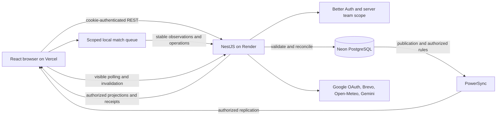
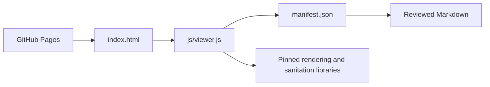

# System Architecture Overview

## Source basis

This documentation describes the clean application checkout on branch `development`, revision **`f23cbd1c53fbc14dd4579467bcb38f43df0335d0`**, inspected on **10 October 2026**. Current source, request schemas and ordered SQL migrations are the implementation authority. Source links on updated pages are pinned to this revision. Hosted deployment, installed migration state, field readiness and stakeholder acceptance were not inspected or established.

Application repository: [SportCoachingTool](https://sdp.ms.wits.ac.za/SDP-Interlude/SportCoachingTool/src/commit/f23cbd1c53fbc14dd4579467bcb38f43df0335d0/). This static documentation portal is a separate repository/runtime.

## Application architecture

### Frontend and shared domain

React/TypeScript and React Router form a Vite SPA with public, team and claimed-player experiences. TanStack Query maintains server state; the shared credentialed fetch wrapper invalidates after successful writes. Visible pages normally poll every five seconds; session refresh is fifteen seconds, with match/weather/public-dashboard overrides. Edit drafts remain intact. See [refresh](../automatic-data-refresh.md).

`frontend/src/offline/` prepares scoped match data and queues observations/operations before upload. PowerSync/Web SQLite supports authorized replicated state when configured. `packages/match-domain` shares match rules/reducers/projection logic across frontend and backend; it is an application package, not a remote service.

### Backend and persistence

NestJS runs on Express. Controllers validate canonical Zod requests, services resolve session/team/role and SQL/Drizzle enforces identity, transactions and reconciliation. Current schema has 42 tables and 29 enums, including shared sessions/participants, private sheets, evidence, reviews, operations, projections, receipts, telemetry and amendments. SQL functions serialize shared clocks/reviews/publication and reject stale/locked commands. See [schema](../data/database-schema.md), [module map](../application-structure.md) and [authorization](../contracts-and-authorization.md).

### Public/private boundary

Linked teams keep separate private event/sheet IDs for the same fixture/session. Public timeline, score, clock, confirmed lineup and formation geometry are shared through safe projections. Private tactics, notes, injuries, draft setup and roster IDs remain excluded. Initial final approval is bilateral for connected teams, with the checked unconnected competition-opponent exception; amendments preserve the published result until approved. See [collaboration](../offline-collaboration.md).

### Communication and providers

REST polling/invalidation supplies ordinary updates; local capture → upload → reconciliation → authorized reads/replication supplies collaboration. Installed Socket.io packages/adapter do not establish an implemented socket broadcast. Public Swagger UI/JSON/YAML exclude protected APIs. Their intended six-route policy differs from the current controller, which adds a seventh public fixture route; see [Swagger policy and current source discrepancy](../api-guide.md#swagger-policy-and-current-source-discrepancy) in the API guide. Public and protected API contracts are both documented in the [API guide](../api-guide.md).

The backend uses Open-Meteo geocoding/forecast (process-local cache and recent stale fallback), Brevo for configured transactional mail, Google OAuth and optional Gemini narrative/assistant services. Production email flows fail closed without delivery configuration; development can log verification links. Provider credentials stay server-side.

## Deployment prerequisites

Vercel configuration rewrites `/auth/*` and `/api/*` to Render and caches hashed `/assets/*` for one year with immutable headers. Neon logical replication, publication/grants, compatible sync rules and signing trust must match the effective target. Apply the full current migration journal before dependent backend/frontend changes; retain upload compatibility for pending devices. See [operations](../operations/offline-operations-runbook.md) and [PowerSync security](../security/powersync-security.md). Configuration files and CI jobs do not prove a successful run or deployment.

## Documentation portal

The viewer reads the root manifest for navigation, renders Markdown/tables/Mermaid and sanitizes content. `npm run manifest` regenerates navigation and canonical LF byte sizes; documentation validation checks local links, inventory and sizes. No Docusaurus application build is required. Historical mockups/UML remain labeled historical.

Sources: [frontend/src/App.tsx](https://sdp.ms.wits.ac.za/SDP-Interlude/SportCoachingTool/src/commit/f23cbd1c53fbc14dd4579467bcb38f43df0335d0/frontend/src/App.tsx), [backend/src/app.module.ts](https://sdp.ms.wits.ac.za/SDP-Interlude/SportCoachingTool/src/commit/f23cbd1c53fbc14dd4579467bcb38f43df0335d0/backend/src/app.module.ts), [packages/match-domain](https://sdp.ms.wits.ac.za/SDP-Interlude/SportCoachingTool/src/commit/f23cbd1c53fbc14dd4579467bcb38f43df0335d0/packages/match-domain), [backend/src/database/schema/index.ts](https://sdp.ms.wits.ac.za/SDP-Interlude/SportCoachingTool/src/commit/f23cbd1c53fbc14dd4579467bcb38f43df0335d0/backend/src/database/schema/index.ts), [frontend/vercel.json](https://sdp.ms.wits.ac.za/SDP-Interlude/SportCoachingTool/src/commit/f23cbd1c53fbc14dd4579467bcb38f43df0335d0/frontend/vercel.json).

## AI Declaration

OpenAI Codex was used to assist with the preparation, structure and editing of this documentation. The project team remains responsible for verifying the content and reviewing the final document.
